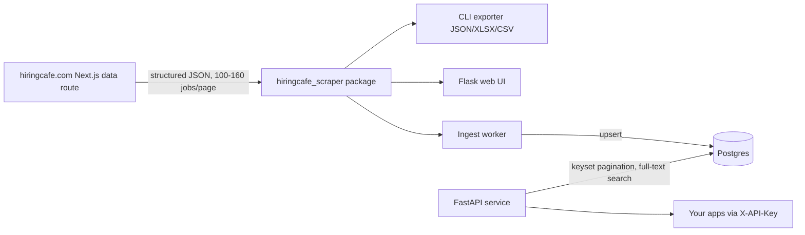

<div align="center">


# HiringCafe Scraper

**Scrape, search, and serve HiringCafe job data — CLI, web UI, and a production-grade API.**

[](https://github.com/CJ7862/HiringCafe-Scraper/actions/workflows/ci.yml)
[](LICENSE)
[](https://www.python.org/)
[](CONTRIBUTING.md)

</div>

---

[HiringCafe](https://hiringcafe.com) indexes 3.6M+ jobs scraped directly from company career pages (Greenhouse, Lever, Workday, and 100+ other ATS platforms), enriched with ~90 structured fields per job: salary ranges, seniority, years of experience, tech stack, benefits flags, and company data.

This project extracts that structured data through HiringCafe's Next.js SSR data routes — no brittle HTML parsing, no headless browser — and gives you three ways to use it:

| Surface | What it does | Good for |
| --- | --- | --- |
| **CLI scraper** | One-shot searches exported to JSON / Excel / CSV | Personal job hunting, datasets, analysis |
| **Web UI** | Local Flask app with filters, live progress, data-quality panel | Interactive exploration without the terminal |
| **API service** | Dockerized FastAPI + Postgres + scheduled ingest worker, API keys, rate limiting | Serving job data to your own apps and users |

## How it works



The scraper bootstraps the site's rotating Next.js `buildId` from the homepage automatically, paginates the search data route politely (~1 request/second with jitter and backoff), and deduplicates on HiringCafe's stable `objectID`.

## Quick start: CLI

```bash
git clone https://github.com/CJ7862/HiringCafe-Scraper.git
cd HiringCafe-Scraper
python3 -m venv .venv && source .venv/bin/activate
pip install -r requirements.txt

python main.py --query "software engineer" --location "United States" --workplace Remote
```

Results land in `results/` as raw JSON plus a flattened 28-column spreadsheet (title, company, salary, seniority, YOE, tech stack, direct ATS apply link, and more).

Common flags (full list: `python main.py --help`):

| Flag | Example | Notes |
| --- | --- | --- |
| `--query` | `"data engineer"` | Keyword / title search |
| `--location` | `"India"`, `"California"`, `"Chicago"` | Geocoded automatically via OpenStreetMap |
| `--workplace` | `Remote Hybrid` | `Remote` / `Hybrid` / `Onsite` |
| `--seniority` | `"Senior Level"` | Four levels supported |
| `--commitment` | `"Full Time"` | Full/part time, contract, internship, ... |
| `--days-old` | `30` | Freshness filter |
| `--validate` | | Data-quality report: verifies every job against your filters |
| `--formats` | `json xlsx csv` | Any combination |

### Data-quality validation

`--validate` checks every scraped job against your search criteria — workplace, seniority, commitment, and location as hard filter checks, query relevance as a soft check — then prints per-filter match rates, adds `filter_match` / `validation_issues` columns to exports, and writes a full JSON report.

## Quick start: Web UI

```bash
python webapp/app.py
# open http://127.0.0.1:5001
```

Search form with filter pills, live scrape progress, a data-quality panel with per-filter match rates, an inline results table with per-row match indicators, and one-click downloads.

## Quick start: API service (production)

A self-contained Docker Compose stack: Postgres + Redis + FastAPI + a scheduled ingest worker that keeps the database fresh (10k+ jobs/day with incremental early-stop).

```bash
cp .env.example .env   # set POSTGRES_PASSWORD and ADMIN_TOKEN
docker compose up -d --build

# issue an API key
curl -X POST http://localhost:8000/v1/admin/keys \
  -H "Authorization: Bearer $ADMIN_TOKEN" -H "Content-Type: application/json" \
  -d '{"name": "my-first-key", "rate_limit_per_minute": 120}'

# query jobs
curl "http://localhost:8000/v1/jobs?q=engineer&workplace_type=Remote&limit=5" \
  -H "X-API-Key: hc_live_..."
```

Highlights: hashed API keys (shown once, revocable, per-key rate limits), keyset cursor pagination, Postgres full-text search, usage audit trail, scrape-run observability, security headers, structured logs, non-root containers, Alembic migrations, and a documented VPS + Caddy TLS deployment path.

**Full service documentation: [service/README.md](service/README.md)**

## Project layout

```
hiringcafe_scraper/     core scraping package (client, search, validator, exporter)
main.py                 CLI entry point
webapp/                 Flask web UI
service/                production API service (FastAPI + Postgres + Redis + worker)
docker-compose.yml      one-command deployment of the API service
.github/workflows/      CI: lint, unit + integration tests, docker build
```

## Contributing

Contributions are welcome! Please read [CONTRIBUTING.md](CONTRIBUTING.md) for dev setup, test instructions, and PR guidelines, and our [Code of Conduct](CODE_OF_CONDUCT.md). Security issues: see [SECURITY.md](SECURITY.md).

## Disclaimer

This project is intended for **educational and research purposes**.

- It is **not affiliated with, endorsed by, or connected to HiringCafe** in any way.
- HiringCafe aggregates job postings from public company career pages; this tool reads the same publicly served data, politely (~1 req/sec, backoff on rate limits). Do not circumvent the built-in politeness defaults.
- You are solely responsible for ensuring your use complies with HiringCafe's Terms of Service, `robots.txt`, and the laws of your jurisdiction — especially for high-volume or commercial use.
- The maintainers assume no liability for misuse.

## License

[MIT](LICENSE) © 2026 CJ7862 and contributors
